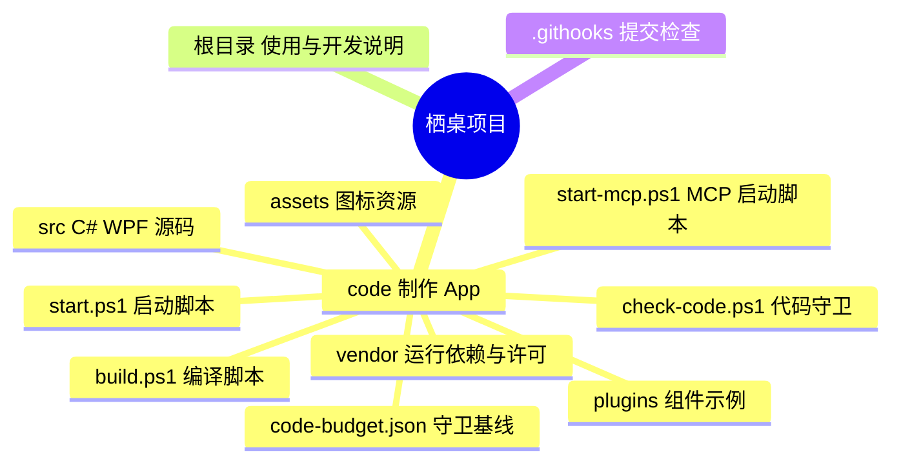

# 栖桌项目目录图

Git 仓库只包含 `code/`、根目录开发说明和提交检查钩子。编译结果、分享包、研究资料、参考程序和临时文件只在本地保留。

## `code/` 里的文件

| 内容 | 位置 |
| --- | --- |
| 主程序、数据和桌面分组 | [code/src/Program.cs](code/src/Program.cs)、[code/src/Core.cs](code/src/Core.cs)、[code/src/Controller.cs](code/src/Controller.cs)、[code/src/FenceWindow.cs](code/src/FenceWindow.cs) |
| 公共函数库（渐进抽取） | [code/src/Functions.cs](code/src/Functions.cs)：文件属性、原子写、UI 线程调度等跨模块基础操作 |
| 系统访问收拢 | [code/src/SystemAccess.cs](code/src/SystemAccess.cs)：桌面、图片、文档、最近、Program Files、数据目录与环境变量只在这里读操作系统，支持 exe 旁 `system.json` 覆盖，便于测试与便携运行 |
| 管理界面和设置 | [code/src/ManagerWindow.cs](code/src/ManagerWindow.cs)、[code/src/SettingsPages.cs](code/src/SettingsPages.cs) |
| 自动排列 | [code/src/GroupArrangement.cs](code/src/GroupArrangement.cs) |
| 文件、搜索和缩略图 | [code/src/FileFeatures.cs](code/src/FileFeatures.cs)、[code/src/WorkspaceSearch.cs](code/src/WorkspaceSearch.cs)、[code/src/Thumbnails.cs](code/src/Thumbnails.cs) |
| 快捷方式图标 | [code/src/ShortcutIcons.cs](code/src/ShortcutIcons.cs)：只改 `.lnk` 自己记录的图标位置，可恢复默认 |
| 自定义显示图标 | [code/src/CustomIcons.cs](code/src/CustomIcons.cs)：任意桌面项指定图标来源，只改栖桌内显示，重命名迁移、来源失效回退；渲染入口 `FileIconPresentation.Themed`（[AppIconSkins.cs](code/src/AppIconSkins.cs)） |
| 应用图标皮肤 | [AppIconSkins.cs](code/src/AppIconSkins.cs) 共用匹配与渲染；[IconSkinSettings.cs](code/src/IconSkinSettings.cs) 提供预览和一键恢复；[素材与许可](code/assets/icon-skins/README.md) |
| 全盘快捷搜索 | [QuickSearch.cs](code/src/QuickSearch.cs) 共用快捷栏与桌面组件；[EverythingSdk.cs](code/src/EverythingSdk.cs) 处理 Everything 异步消息查询，CLI 和有限本机搜索作为备用 |
| Everything 运行依赖 | [code/vendor/everything](code/vendor/everything/README.md) 包含官方 x64 程序、语言包、SDK DLL、ES 及许可；[EverythingRuntime.cs](code/src/EverythingRuntime.cs) 统一查找路径，构建自动复制到 `dist/Everything/` |
| 文件就地重命名 | [InlineFileName.cs](code/src/InlineFileName.cs) 显示编辑器；[FileRenaming.cs](code/src/FileRenaming.cs) 更新名称引用与持久化恢复记录，布局撤销保留真实文件的新路径 |
| 桌面工作区与小猫 | [Controller.Workspaces.cs](code/src/Controller.Workspaces.cs) 统一选择、层级、收起和旧标签迁移；[FenceWindow.Search.cs](code/src/FenceWindow.Search.cs) 负责分区内搜索与折叠悬停；[DesktopPet.cs](code/src/DesktopPet.cs) 负责桌宠。旧 [WorkspacePanel.cs](code/src/WorkspacePanel.cs) 只剩托盘右键「工作区面板」一个入口（`ManagerWindow.ShowWorkspacePanel`），Alt＋Space 和小猫点击都走 `Controller.ToggleSelectedWorkspace`，不再经过面板 |
| 分区标签栏 | [PartitionTabs.cs](code/src/PartitionTabs.cs) 把分区自身、文件夹映射和合并分区统一成同一种标签；[Controller.Tabs.cs](code/src/Controller.Tabs.cs) 负责标签拖出成独立分区、拖入合并和文件夹映射移动 |
| AI 布局档案 | [LayoutArchives.cs](code/src/LayoutArchives.cs) 负责 `desktop-layouts.json` 的读写、校验、模板排布和整理计划；[LayoutCommands.cs](code/src/LayoutCommands.cs)、[LayoutBridge.cs](code/src/LayoutBridge.cs)、[LayoutCli.cs](code/src/LayoutCli.cs) 提供 MCP/CLI 应用入口 |
| 分区忽略与设置布局 | [PartitionIgnores.cs](code/src/PartitionIgnores.cs) 统一全局、分区与组合分区规则；[IgnoreSettings.cs](code/src/IgnoreSettings.cs) 管理继承例外；[SettingsLayout.cs](code/src/SettingsLayout.cs) 负责设置页面重排 |
| 小猫形象素材 | [code/assets/cat](code/assets/cat)：来自 `references/PathCat-main` 的两套状态图，编译时复制到 `dist/cat`；来源与授权见 [SOURCE.md](code/assets/cat/SOURCE.md) |
| 组件与插件 | [code/src/Widgets.cs](code/src/Widgets.cs)、[code/src/ComponentPackages.cs](code/src/ComponentPackages.cs)、[code/plugins/examples](code/plugins/examples) |
| MCP 与 AI | [McpBridge.cs](code/src/McpBridge.cs)（工具定义、参数校验、撤销与回执）、[McpSession.cs](code/src/McpSession.cs)（命名管道会话）；工具组：[McpIcons.cs](code/src/McpIcons.cs)（SVG 生成 .ico、自定义/快捷方式图标、皮肤）、[McpDesktop.cs](code/src/McpDesktop.cs)（桌面模式、页面、打开/定位/重命名、媒体、状态）、[McpPanels.cs](code/src/McpPanels.cs)（面板标签）、[McpComponents.cs](code/src/McpComponents.cs)（插件与组件包）；[LayoutCli.cs](code/src/LayoutCli.cs) 用 `--call` 调用任意工具，与 MCP 同一执行面；SVG 子集渲染在 [AppIcon.cs](code/src/AppIcon.cs)。AI 独立进程：[AiCore.cs](code/src/AiCore.cs)（分类逻辑，纯数据进出）、[AiSidecar.cs](code/src/AiSidecar.cs)（`--ai-serve` NDJSON 服务端）、[AiClient.cs](code/src/AiClient.cs)（主程序侧进程与协议客户端），约定见 [AI-SIDECAR.md](code/AI-SIDECAR.md) |
| 测试代码（单独编译） | [code/src/tests](code/src/tests)：只编译进 `Tests-QiDesk-*.exe`，正式程序与 MCP 产物不含测试入口 |
| 编译、启动、图标 | [code/build.ps1](code/build.ps1)、[code/start.ps1](code/start.ps1)、[code/start-mcp.ps1](code/start-mcp.ps1)、[code/assets](code/assets) |
| 代码守卫 | [code/check-code.ps1](code/check-code.ps1) 在构建后和提交前检查新增违规；基线 [code/code-budget.json](code/code-budget.json) 记录每个文件允许保留的额度；规矩与失败案例见 [CODE-RULES.md](CODE-RULES.md) |

## 不提交到 Git 的本地目录

- `dist/`：编译生成的 EXE、最新版本指针和测试产物。
- `output/`：可分享的压缩包和历史导出文件。
- `research/`、`整理/`、`策划/`：研究、需求和历史评审素材。
- `references/`、`tools/`：外部参考和本地验证工具，运行不依赖这些目录。Everything 的必要运行文件已纳入 `code/vendor/everything/`。
- `tmp/`、`experimental/`：历史临时资料和实验内容。

编译运行：在仓库根目录的 PowerShell 中执行 `& .\code\build.ps1`，然后执行 `& .\code\start.ps1`。个人设置位于 `%LOCALAPPDATA%\QiDesk`，不在这个项目目录中。
