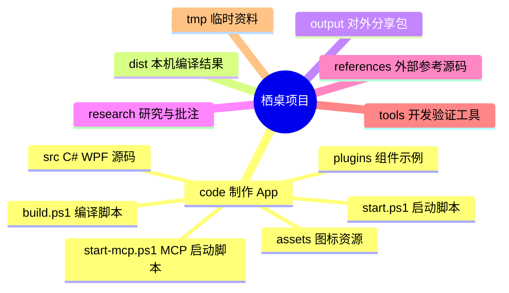

# 栖桌项目目录图

`code/` 只放制作这款 App 所需的文件。编译结果、分享包、研究资料、参考程序和临时文件都放在 `code/` 外。

## `code/` 里的文件

| 内容 | 位置 |
| --- | --- |
| 主程序、数据和桌面分组 | [code/src/Program.cs](code/src/Program.cs)、[code/src/Core.cs](code/src/Core.cs)、[code/src/Controller.cs](code/src/Controller.cs)、[code/src/FenceWindow.cs](code/src/FenceWindow.cs) |
| 公共函数库（渐进抽取） | [code/src/Functions.cs](code/src/Functions.cs)：文件属性、原子写、UI 线程调度等跨模块基础操作 |
| 管理界面和设置 | [code/src/ManagerWindow.cs](code/src/ManagerWindow.cs)、[code/src/SettingsPages.cs](code/src/SettingsPages.cs) |
| 自动排列 | [code/src/GroupArrangement.cs](code/src/GroupArrangement.cs) |
| 文件、搜索和缩略图 | [code/src/FileFeatures.cs](code/src/FileFeatures.cs)、[code/src/WorkspaceSearch.cs](code/src/WorkspaceSearch.cs)、[code/src/Thumbnails.cs](code/src/Thumbnails.cs) |
| 工作区面板与桌面小猫 | [code/src/WorkspacePanel.cs](code/src/WorkspacePanel.cs)、[code/src/PanelFiles.cs](code/src/PanelFiles.cs)、[code/src/DesktopPet.cs](code/src/DesktopPet.cs) |
| 组件与插件 | [code/src/Widgets.cs](code/src/Widgets.cs)、[code/src/ComponentPackages.cs](code/src/ComponentPackages.cs)、[code/plugins/examples](code/plugins/examples) |
| MCP 与 AI | [code/src/McpBridge.cs](code/src/McpBridge.cs)、[code/src/Ai.cs](code/src/Ai.cs) |
| 测试代码（单独编译） | [code/src/tests](code/src/tests)：只编译进 `Tests-QiDesk-*.exe`，正式程序与 MCP 产物不含测试入口 |
| 编译、启动、图标 | [code/build.ps1](code/build.ps1)、[code/start.ps1](code/start.ps1)、[code/start-mcp.ps1](code/start-mcp.ps1)、[code/assets](code/assets) |

## `code/` 外面的文件

- [dist](dist)：编译生成的 EXE、最新版本指针和测试产物；无需放进源码目录。
- [output](output)：可分享的压缩包和历史导出文件。
- [research](research)：研究、真实反馈和历史评审素材；当前桌面分组批注见[这里](research/feedback/desktop-group-20261014.md)。
- [references](references)、[tools](tools)：外部参考和开发验证工具。Everything 属于可选第三方程序，可在应用设置中指定安装位置。
- [tmp](tmp)、[experimental](experimental)：历史临时资料和实验内容。

编译运行：在 PowerShell 中执行 `& D:\fences\code\build.ps1`，然后执行 `& D:\fences\code\start.ps1`。个人设置位于 `%LOCALAPPDATA%\QiDesk`，不在这个项目目录中。
