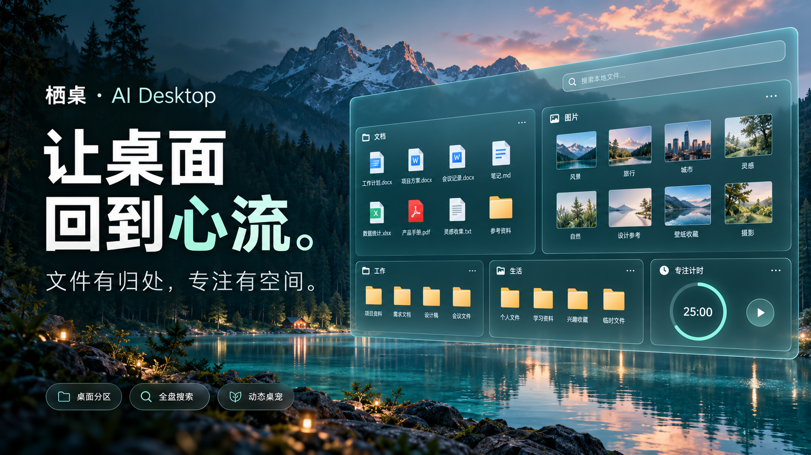
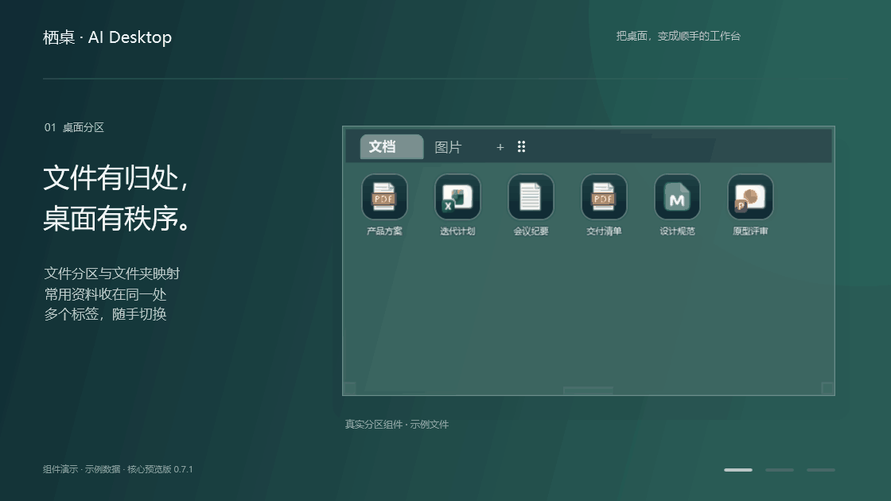
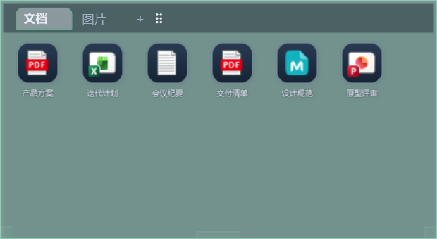
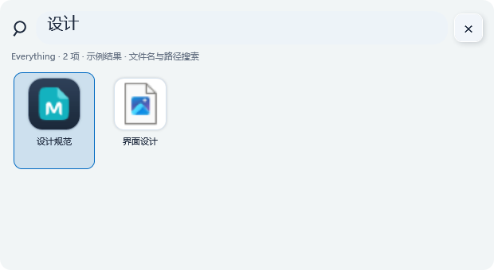
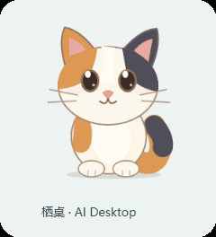

# 栖桌 · AI Desktop

### 文件有归处，专注有空间。

桌面分区 · Everything 搜索 · 动态矢量桌宠 · AI 整理接口

[看功能动图](#先看它怎么工作) · [主要功能](#还有这些顺手的小事) · [开始体验](#开始体验) · [反馈与想法](https://github.com/Oxygen-Wang/AI-Desktop/issues)

品牌概念图，展示视觉方向；实际界面见下方功能演示。

每天打开电脑，文件、项目和灵感都在桌面上等你。

**栖桌想让它们各就各位，也让你更快回到手头的事。** 把资料收进分区，把常用项目留在手边，用快捷键找回文件，再让一只会动的小猫陪你工作。

## 先看它怎么工作

**12 秒，三个场景：整理资料 → 搜索文件 → 小猫陪伴。**

▶ **[观看 / 下载 MP4 演示](https://github.com/Oxygen-Wang/AI-Desktop/raw/refs/heads/main/code/assets/readme/feature-tour.mp4)**

真实组件演示 · 使用示例文件与示例搜索结果，非个人桌面录屏。

## 01 · 把桌面，整理成你的工作台

项目文档、图片素材、常用入口，放进各自的分区。需要的内容留在眼前，暂时不用的内容折叠收起。

- **拖进来，就归位。** 文件和快捷方式支持拖入、拖出，常见操作直接在分区内完成。
- **一个分区，多个标签。** 文档、图片、文件夹映射可以切换，也可以合并或拆成独立分区。
- **工作区随叫随到。** 选中常用分区，按 `Alt+Space` 或点击小猫，将这些原分区一起提到前台。

  

同一分区，切换标签即可换一组内容。<a href="code/assets/readme/partition-pictures.png">查看图片标签</a>

## 02 · 记得名字，就能找到

按下 `Ctrl+Alt+Space`，输入文件名或路径，让 Everything 的索引帮你把文件找出来。

**搜索条可以随时呼出，也可以作为桌面组件常驻。** 选中结果后，`Enter` 打开，`Ctrl+Enter` 在资源管理器中定位。

  

搜索全部显示 Everything 索引中的结果，不受分区忽略规则影响。未连接 Everything 时会明确显示本机有限范围，搜索桌面与已连接项目。

## 03 · 给桌面，留一点温度

  

一只会呼吸、眨眼、摆尾，也会打瞌睡的三花小猫。

它也是工作区入口：**点击唤起选中的分区，拖动换个位置，右键调整形象与大小。** 矢量绘制可以清晰缩放，不再依赖整套位图状态帧。

## 还有这些顺手的小事

| 功能 | 能帮你做什么 |
| --- | --- |
| **分区内搜索与重命名** | `Ctrl+F` 在当前分区搜索；`F2` 就地修改文件名，减少来回切换窗口。 |
| **排序与自动整理** | 按名称、类型、修改时间或大小排列；按需启用文件类型和名称规则。 |
| **忽略规则** | 导入 Git 风格规则；全局规则与分区独立修改结合使用，组合分区共用规则。 |
| **颜色与图标皮肤** | 调整配色、透明度与圆角；切换 Fluent / Papirus 应用图标皮肤，或自定义单项显示图标。 |
| **布局与快照** | 保存布局、恢复快照、撤销布局调整，适应不同工作内容。 |
| **桌面组件** | 时钟、待办、番茄钟等工具放在桌面，需要时添加。 |
| **MCP 与命令行** | 将桌面管理能力交给已连接的 AI 客户端，复用同一套工具接口。 |

## 让 AI 帮你安排，具体怎么做由你决定

可以连接模型服务生成整理建议，预览后选择应用；也可以把 MCP 工具接入支持它的 AI 客户端，用自然语言表达整理意图。

> “把这批资料里的 PDF 放进文档分区，图片单独一栏，先给我看看整理计划。”

AI 可通过工具读取布局、管理分区、调整外观、组织文件归属和安装组件。布局操作支持撤销与回执；实际执行范围取决于连接方式和授权。

[查看 AI 整理能力与接入说明 →](code/skills/qidesk-organizer.md)

## 开始体验

当前是 **0.7.1 核心预览版**，提供源码构建，尚未发布稳定版安装包。

1. [下载源码](https://github.com/Oxygen-Wang/AI-Desktop/archive/refs/heads/main.zip)，按[开发指南](CONTRIBUTING.md)构建，打开生成的栖桌主程序。
2. 在控制面板创建分区或添加文件夹映射，启动桌面模式。
3. 把常用资料拖进分区；使用搜索全部前，在“文件搜索”页启动并检查 Everything 索引连接。

`code/` 已包含应用源码、资源、测试、构建脚本及 Everything 运行依赖，无需从本机研究目录补文件。AI 服务需要自行配置。

### 整理之后，也能回到原桌面

“停止桌面 · 恢复 Windows 图标”用于恢复原生桌面，“完全停止栖桌”用于退出应用。已整理项目保留恢复记录；移除分区与删除磁盘文件是不同操作。

多显示器、不同 DPI、Explorer 重启及与其他桌面工具同时运行的行为仍在持续验证。欢迎通过 [Issues](https://github.com/Oxygen-Wang/AI-Desktop/issues) 提交复现步骤和建议。

<strong>展开快捷键速查</strong>

| 快捷键 | 操作 |
| --- | --- |
| `Alt+Space` | 将选中的分区提到前台 / 放回桌面层 |
| `Ctrl+Alt+Space` | 呼出 / 收起搜索全部 |
| `Ctrl+F` | 打开 / 关闭当前分区搜索 |
| `F2` | 就地重命名选中文件 |
| `Ctrl+Alt+Backspace` | 取消全部工作区选择 |

<strong>开发文档与素材来源</strong>

- [开发指南](CONTRIBUTING.md) · [源码导航](PROJECT_MAP.md) · [代码规则](CODE-RULES.md)
- [详细交互说明](code/README.md) · [AI 进程协议](code/AI-SIDECAR.md)
- [Fluent 界面图标许可](code/assets/fluent/LICENSE) · [应用图标皮肤](code/assets/icon-skins/README.md)
- [矢量桌宠说明](code/assets/cat/SOURCE.md) · [Everything 依赖与许可](code/vendor/everything/README.md)
- [概念图提示词与功能素材生成说明](code/assets/readme/README.md)

图片与第三方组件的来源、版权和许可保留在各自目录中。

---

<strong>让打开电脑的第一眼，更轻松一点。</strong> 喜欢这个方向，欢迎点亮 Star，或带着你的桌面场景来聊聊。

