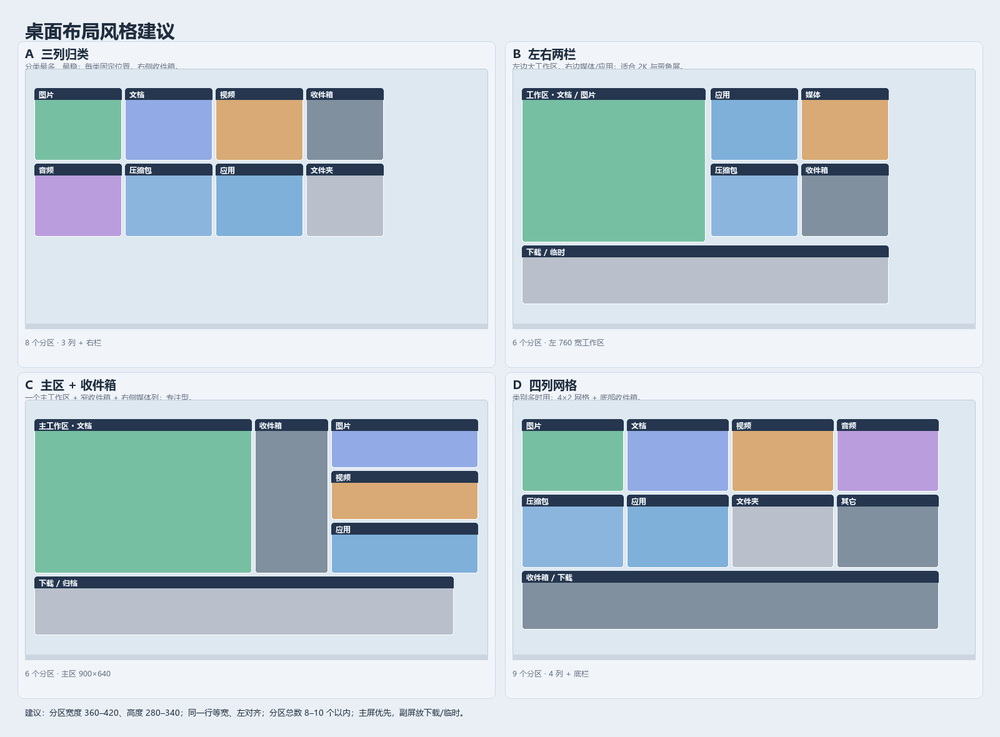

# AI 可编辑的桌面布局档案（JSON）与多存档需求

日期：2026-10-17
状态：P0 已实现（单文件多存档、模板、预览/应用/撤销、CLI 与 MCP）；需求与格式保留，实施记录见第十一节。

## 一、场景

用户希望：

> AI 可以按照规则整理桌面。比如后缀 `*.png` 放图片、文档放一起，有规则的分类。AI 生成一个 JSON，就是一些分区和规则；整个桌面的布局规则最后保存为 JSON，AI 读取这个 JSON，修改后应用，桌面就有结果。这个 JSON 可以保存多个存档。

本轮已明确的偏好：

- 桌面位置也写进同一个 JSON，并允许 AI 修改。
- **一个 JSON 文件里放多个存档**，不再拆成多个文件和索引文件。
- 未匹配项目默认留在桌面。
- 默认布局不是 AI 的强项：由程序提供布局模板和风格建议，AI 主要负责分区和规则，坐标可选。
- 不要求“手动拖过的项目默认受规则保护”。
- AI 应用通道需要给出 MCP 或 CLI 的建议。

目标流程：

1. AI 读取一份可读的 `desktop-layouts.json`。
2. AI 选择/新增一个存档，按后缀、名称、文件/文件夹等规则增删分区。
3. 应用前预览：哪些分区新增/消失/移动，哪些文件换分区，哪些留在桌面。
4. 用户确认后一次性应用，窗口重建，可撤销。
5. 工作、游戏、演示等场景各存一个存档，切换时整套分区、规则和位置一起切换。

## 二、现有基础与差距

| 已有能力 | 位置 | 与本次需求的关系 |
| --- | --- | --- |
| `state.json` 保存全部分区、规则、归属、位置、外观 | [Core.cs](../../code/src/Core.cs) | 运行时数据已经齐全，但它是内部全量状态，含恢复映射、界面偏好等，不适合作为 AI 的稳定编辑契约 |
| `Group` 分区与 `Rule` 规则（扩展名、名称包含/开头/结尾、文件/文件夹） | [Core.cs](../../code/src/Core.cs) | 可直接映射到档案，不需要第二套规则引擎 |
| `Store.Match` 按顺序首次匹配；找不到时回退到“收件箱”或任意普通分区 | [Core.cs](../../code/src/Core.cs) | 整理时语义不够严格；档案应用需要“未匹配就按 fallback”的严格版本 |
| “整理散落图标”只处理尚未归属的桌面图标 | [Controller.cs](../../code/src/Controller.cs) | 新需求要能重新计算已在分区内的项目 |
| 布局快照保存整份 `State` 副本；`LayoutProfiles` 只保存每个显示器的几何位置 | [Core.cs](../../code/src/Core.cs)、[ManagerWindow.cs](../../code/src/ManagerWindow.cs) | 快照不是命名档案，也不区分“分区/规则/布局”；不能直接给 AI 编辑 |
| MCP 已有 `qidesk_get_layout`、`qidesk_set_rules`、`qidesk_update_group`、`qidesk_apply_rules` | [McpBridge.cs](../../code/src/McpBridge.cs)、[AiSettings.cs](../../code/src/AiSettings.cs) | 可以改局部，但没有档案的读取、保存、预览、应用和多存档 |
| AI 推荐只返回“文件 → 已有分区”的建议 | [Ai.cs](../../code/src/Ai.cs) | 只能选已有分区；不能生成分区、规则和布局模板 |

主要差距：

1. 没有面向 AI 的稳定、版本化、可读的配置格式。
2. 没有“存档 = 分区 + 规则 + 布局 + 桌面位置”的整体应用流程。
3. 没有多存档的命名、切换、应用记录和冲突处理。
4. 规则应用只覆盖散落图标，不能把已在错误分区的项目重新归类。
5. 没有应用前差异预览和一次性原子提交。
6. 没有布局模板，AI 需要自己算坐标，容易排出不适合屏幕的布局。

## 三、术语与原则

- **配置文件（`desktop-layouts.json`）**：一个 JSON，顶层包含多个存档和一些全局设置。
- **存档（Archive）**：一套分区、规则、页面、桌面位置和 fallback；切换存档就是切换这一整套。
- **应用（Apply）**：校验存档，替换分区/规则/布局，并按需重新整理归属。
- **整理（Organize）**：按规则重新计算桌面项目的分区归属，只改栖桌的归属记录，不移动、不删除真实文件。
- **布局模板（Template）**：程序内置的排布算法；分区没写坐标时由模板计算位置，AI 不必自己算像素。
- **运行时状态**：`%LOCALAPPDATA%\QiDesk\state.json`，仍是程序的实际数据源；配置文件只在“应用/保存”时读写。

原则：

1. JSON 是 AI 与栖桌之间的契约；未知字段、非法目标、越界数值必须拒绝，不能“尽量猜”。
2. 应用必须显式触发，默认不监听文件后立刻重排桌面。
3. 应用前必须预览差异；应用必须可撤销，并在应用前保存恢复点。
4. 只改变栖桌归属与布局；真实文件的移动、删除继续走现有文件操作，不因档案应用发生。
5. AI 只读取文件名、后缀、大小、时间等元数据；不读取文件内容。
6. 复用现有 `Group`、`Rule`、`Store.Match`、`Store.Checkpoint`、`Controller.SaveAndRefresh`、`Layout`，不另建规则引擎和排布引擎。
7. 一份 JSON 文件保存多个存档，但每份存档的内容相互独立；切换时不共享可变对象。

## 四、功能需求

### R1 单文件、多存档与修订

- 唯一文件：`%LOCALAPPDATA%\QiDesk\desktop-layouts.json`。
- 顶层字段：`schema`、`revision`、`updatedAt`、`active`、`settings`、`archives`。
- `archives` 是数组，每项是一份完整存档；`active` 是当前存档的 `id`。
- 程序在 `state.json` 中记录 `ActiveLayoutArchiveId` 和 `LastAppliedLayoutRevision`；启动时以配置文件的 `active` 为准，读不到或非法时回退到 state 中记录的值。
- 文件使用 UTF-8、缩进格式，便于阅读和 diff。
- 所有写入使用临时文件 + 原子替换；不得写出半份 JSON。
- 每次写入递增顶层 `revision`；保留最近 10 个 `desktop-layouts.json.bak-<时间>`。
- 限制：存档最多 50 份，单文件最多 2 MB；每档分区最多 200，规则最多 100（与现有 MCP 单次写入上限一致）。
- 外部修改通过 `revision`/修改时间识别；界面标记“有未应用修改”，不自动应用（P0）。
- 删除存档只从 `archives` 中移除，并在 `.bak` 中保留；不改运行时布局，不删除文件。

### R2 分区与桌面位置

分区字段：

- `id`：存档内的稳定键，小写字母、数字、`-`、`_`，1–40 字符；规则用它指向目标。
- `name`、`page`、`x`、`y`、`width`、`height`、`color`。
- `source.type`：`rules`（规则收集）、`folder`（文件夹映射）、`manual`（只放手动项目）。
- `source.folders`：`folder` 类型使用，允许一个或多个目录。
- `appearance`：边角、不透明度、背景、图标大小、视图模式等可选覆盖。
- `items`：可选，手动放入的项目路径；规则匹配的项目不需要列出。
- `sort`、`locked`：可选。

桌面位置规则：

- `x`/`y`/`width`/`height`/`page` 是权威位置。AI 修改后应用即移动/缩放分区。
- 分区没写坐标时，使用存档级 `layout.template` 计算；写了坐标则以此为准。
- `layout.template` 方案：`three-columns`（三列归类）、`two-columns`（左右两栏）、`focus-inbox`（主区 + 收件箱）、`grid`（四列网格）、`stack-right`（右侧竖排）。可带 `gap`、`margin`。
- 应用前按当前工作区校验：越界/屏幕外按 `Layout.EnsureVisible` 或等比缩放修正；副屏负坐标保留；空间不足时阻止并提示，不能静默叠在一起。
- `locked` 只阻止用户拖动，不阻止档案应用；预览中明确列出位置变化。
- 运行时把档案 `id` 映射到 `Group.Id`，并在 `Group` 上保存 `ArchiveKey`。应用时按 `ArchiveKey` 匹配现有分区，保留运行时 ID、忽略规则和用户外观；没有匹配则新建。
- 档案中不存在、运行时存在的分区：预览中列出；应用时释放其项目，不删除真实文件。
- 重复 `id`、非法颜色、宽高越界、页面越界全部拒绝。

### R3 分类规则

规则数组顺序就是优先级，**首次匹配生效**，与现有 `Store.Match` 一致；一条规则内多个条件是 AND。

第一批支持的条件：

| 字段 | 含义 |
| --- | --- |
| `extensions` | 后缀数组，不带点、大小写不敏感，例如 `["png","jpg"]` |
| `kind` | `file`、`folder` 或 `any` |
| `name.contains` / `name.prefix` / `name.suffix` | 文件名条件，大小写不敏感 |
| `enabled` | 是否参与匹配 |
| `target` | 目标分区 `id`，必须存在 |

映射到现有 `Rule`：`extensions` → `Extensions`；`name.contains` → `Contains` 且 `NameMode=包含`；`name.prefix` → `NameMode=开头`；`name.suffix` → `NameMode=结尾`；`kind` → `Kind`（文件/文件夹/全部）。后续条件（大小、修改时间、AND/OR/NOT）再扩展，不提前引入表达式树。

规则要求：

- 后缀匹配只比较扩展名；`.tar.gz` 按 `gz` 处理，需要时写 `gz` 规则。
- 只处理桌面顶层项目（当前用户桌面 + 公共桌面）；不递归文件夹内容。
- 已忽略的项目保持忽略；`state.Excluded` 中明确移出的项目不参与重新归类。
- 文件夹映射分区的内容不被规则移动；文件夹规则只匹配桌面顶层文件夹。
- `fallback.target` 指定未匹配项目的收件箱；`fallback.unmatched` 为 `desktop` 时未匹配项目留在桌面。**默认是留在桌面**；只有档案明确写 `"unmatched":"partition"` 且给出 `target` 时才自动收集未匹配项目。
- 不能像现有 `Store.Match` 那样回退到任意分区。
- 提供图片、文档、视频、音频、压缩包、应用/快捷方式、文件夹等分类预设，但档案中保存**展开后的后缀列表**，保证结果可复现。
- 预览逐项给出：路径、命中的规则、原分区、目标分区；同时命中的后续规则标记为“被更高优先级规则覆盖”。
- 规则和分区 `id` 在档案内唯一；规则目标不能指向不存在的分区。

示例档案见 [layout-archive-example.json](../layout-archive-example.json)。

### R4 应用与整理

应用分两步，可分别选择：

1. **布局应用**：写入分区定义、规则、页面、几何、外观。
2. **整理桌面**：按规则重新计算项目归属。

推荐默认：两者同时执行，界面上提供“只应用布局，不移动项目”的复选项。用户未特别说明时按“布局 + 整理”执行。

应用流程：

1. 读取并校验 JSON（schema、字段、目标、路径、重复 ID、上限）。
2. 生成差异预览：
   - 分区：新增、删除、位置/尺寸/外观变化；
   - 规则：新增、删除、修改、顺序变化；
   - 项目：将进入哪个分区、来自哪个分区、命中哪条规则；
   - 未匹配项目的去向。
3. 用户确认后，保存快照（`snapshots/before-layout-<时间>.json`）并 `Store.Checkpoint()`。
4. 在克隆状态上替换分区/规则并 `Store.Validate`；任何错误在写入前失败。
5. 应用整理计划：修改项目归属，必要时设置隐藏/受管记录。
6. 一次性保存并重建窗口；失败则回滚到快照，不留下半应用状态。
7. 显示结果回执：分区数、规则数、移动项目数、未匹配数、失败原因、可撤销提示。

整理范围与保护：

- 默认重新计算所有桌面顶层项目，而不仅是散落图标；这是“应用就有结果”的关键。
- `state.Excluded` 中的项目、被全局/分区忽略的项目、文件夹映射里的内容不参与移动。
- 手动项目保护不在本轮需求内；应用前用预览和撤销兜底，用户确认后规则可以覆盖手动归属。
- 规则目标分区被删除时，规则无效并在校验阶段拒绝，而不是运行时静默跳过。
- 应用只改归属，不移动磁盘文件；桌面模式下由现有 `DesktopOrganization.Sync` 处理隐藏/受管，停止桌面模式后恢复原桌面。

### R5 多存档管理

- 所有存档都在同一个 `desktop-layouts.json` 的 `archives` 数组里；`active` 记录当前存档。
- 新建：把当前运行时布局追加为一档，或复制一份现有存档再改。
- 列表：名称、分区数、规则数、更新时间、是否激活、是否有未应用修改。
- 切换：先预览目标存档对当前桌面的影响；应用后把 `active` 改为目标，旧存档保持自己的分区、规则和位置。
- 保存：把当前布局写回 `active` 对应存档，递增顶层 `revision`。
- 重命名、复制、删除、导出、导入都在同一个文件内完成；导出可只导出单份存档，导入可追加或替换同名存档。
- 每份存档独立保存自己的分区、规则、几何、页面和 fallback；`settings` 是全局的，不随存档切换；AI 连接也在 `settings` 中，切换存档不改变 AI 连接。
- 重启后保留当前激活存档和 `revision`。
- 多存档之间不共享可变的分区/规则对象；应用时深拷贝或重建，避免串配置。
- 文件被外部修改时，应用前比较 `revision`；不一致时提示“配置文件已被修改，是否重新读取并预览”，不能静默覆盖。
- 保存分两种：P0 采用手动“保存当前布局到存档”，界面显示“有未保存到存档的修改”；P1 可增加“自动保存激活存档”，需防抖，并在检测到外部修改时暂停写入、标记冲突，不能覆盖 AI 或用户刚写入的内容。
- 每次保存/应用更新顶层 `revision`、`updatedAt` 和 `active`；应用结果写入 `state.json`，不反向改写 AI 正在编辑的文件。

### R6 AI 接口

#### 文件方式

- 在设置/布局页显示配置文件路径，并允许“在资源管理器中打开”。
- AI 直接读取和修改 `desktop-layouts.json`；界面检测到变化后提示“有未应用修改”，由用户点击预览/应用。
- 不默认自动应用：防止编辑器保存或半写入文件时触发桌面重排。

#### MCP 工具

建议新增：

| 工具 | 作用 |
| --- | --- |
| `qidesk_get_layout_config` | 返回整个配置文件（或按 `archiveId` 过滤后的存档） |
| `qidesk_save_layout_config` | 校验并写入配置文件，不应用 |
| `qidesk_list_layout_archives` | 列出所有存档及激活状态 |
| `qidesk_preview_layout_archive` | 返回布局与项目差异 |
| `qidesk_apply_layout_archive` | 应用指定存档，可选 `organize` |
| `qidesk_export_current_layout` | 把当前布局保存为命名存档 |

#### MCP 还是 CLI

建议：**MCP 为主，CLI 只做薄封装**。

- MCP 更适合通用 AI 客户端（ChatGPT、OpenCode、Claude 等）：AI 不需要文件系统权限，参数有 schema 校验，结果是结构化的预览/回执，且可以直接调用“应用”。
- CLI 对本地 agent（例如我这种能执行命令的）更直接：`QiDesk.exe --layout-list`、`--layout-preview work`、`--layout-apply work`。
- 两者必须共用同一个 `LayoutArchiveService`，不能各写一套校验。
- CLI 不能启动第二个实例直接改 `state.json`；程序已有单实例互斥，CLI 必须通过运行中实例的命名管道发送请求并等待结果。
- 如果只能选一个：选 MCP。如果只服务本地命令行 AI：CLI 更省事。建议两个都保留，CLI 只是入口，不增加第二套逻辑。

#### AI 自身设置

- 顶层 `settings.ai` 保存 `endpoint`、`model`，AI 可以读取和修改；不保存 API 密钥（继续使用 `QIDESK_AI_KEY` 环境变量）。
- 修改 AI 设置与存档应用分离，单独确认；切换存档不改变 AI 连接。
- 这里按“AI 可以改 AI 自己的连接设置”理解；如果用户本意不是这个，可删除该节，不影响档案主体。

#### AI 输出约束

- 只返回 JSON 对象，不要 markdown、命令或脚本。
- 不写未知字段；不写 shell 命令、URL、可执行路径到规则字段。
- 不读取文件内容；只使用名称、后缀、大小、时间。
- 应用后调用 `qidesk_show_changes` 显示回执，列出改动和涉及的项目。
- 所有 AI 修改可撤销；不能绕过预览直接删除存档或分区。

### R7 安全与校验

- 拒绝未知字段、错误类型、重复 `id`、未知目标、空名称、超长名称、非法颜色、NaN/Infinity、越界坐标和尺寸。
- 路径字段：
  - 文件夹映射必须是存在的本地目录；
  - 支持 `%USERPROFILE%`、`%DESKTOP%`、`%DOWNLOADS%`、`%DOCUMENTS%` 等已知目录令牌；
  - 拒绝路径穿越、网络路径和系统关键目录，除非用户明确选择。
- 不允许配置包含“删除文件”“执行命令”“下载”等动作。
- 单次应用的项目变更数量和预览大小有上限（例如预览最多 2000 项）。
- 原子写入、快照、撤销；失败不改变可用配置。
- 不保存 API 密钥；`settings.ai` 只保存 endpoint/model。
- 不包含剪贴板内容、最近文件等敏感/易变数据。

### R8 界面

“布局和快照”页新增“布局档案”区域：

- 顶部显示配置文件路径和“AI 可编辑”说明；提供打开目录、重新读取。
- 存档卡片/列表：名称、分区数、规则数、更新时间、激活标记、未应用修改标记。
- 按钮：从当前保存、新建、预览、应用、另存、重命名、删除、导出、导入。
- 应用对话框：
  - 显示分区变化和项目变化；
  - 复选项“同时按规则整理桌面”；
  - 明确提示“不会移动或删除磁盘文件”；
  - 位置变化用列表或缩略图显示；
  - 应用后显示回执与撤销入口。
- 错误信息包含字段路径，例如 `archives[0].rules[1].target`，不要只显示“格式错误”。
- 窄窗口下与现有设置页一样单列排列。

### R9 兼容与迁移

- 保持 `state.json` 为运行时数据源，不直接用配置文件替换它；避免破坏现有 8 个版本的迁移链。
- `state.json` 新增 `ActiveLayoutArchiveId`、`LastAppliedLayoutRevision`，旧配置默认空/0。
- `Group` 新增 `ArchiveKey`，旧配置默认空；首次导出/应用时按分区名和 ID 生成稳定键。
- 配置文件只保存分区、规则、布局、AI 连接；桌面恢复映射、隐藏记录、忽略文件、界面偏好仍留在 `state.json`，AI 不能通过配置文件改写恢复记录。
- 旧快照继续可用；档案是新增能力，不改变快照语义。
- 现有 Fences 导入、组件包、MCP 工具保持兼容；档案工具作为新增工具。
- schema 升级时保留旧版本读取器；未知新版本拒绝并提示升级程序。

### R10 记录与可观测性

- 配置文件顶层记录 `revision`、`updatedAt`、`active`。
- `state.json` 记录 `ActiveLayoutArchiveId`、`LastAppliedLayoutRevision`、`LastAppliedAt`。
- 应用回执记录：存档 ID、修订号、分区/规则/项目变更数、失败项；不记录文件内容。
- 预览/应用失败要能定位到具体字段或项目路径。
- 可选：保存最近一次应用的计划摘要，供撤销后对照；不无限增长。

## 五、JSON 规范

完整示例：[layout-archive-example.json](../layout-archive-example.json)。示例包含 `work` 和 `game` 两份存档，并保留显式坐标方便直接复现；实际 AI 生成时如果只写 `layout.template`，可以省略所有 `x`/`y`/`width`/`height`，由程序计算。

顶层字段：

| 字段 | 必填 | 说明 |
| --- | --- | --- |
| `schema` | 是 | 固定 `qidesk.layouts/1` |
| `revision` | 是 | 正整数，每次外部修改递增 |
| `updatedAt` | 是 | ISO 8601 时间 |
| `active` | 是 | 当前存档 `id` |
| `settings` | 否 | 全局设置；P0 仅 `ai.endpoint`、`ai.model` |
| `archives` | 是 | 存档数组，1–50 份 |

存档字段：

| 字段 | 必填 | 说明 |
| --- | --- | --- |
| `id` | 是 | 稳定 ID，`[a-z0-9_-]{1,40}` |
| `name` | 是 | 显示名称 |
| `updatedAt` | 否 | 本存档更新时间 |
| `pages` | 否 | 页数，默认 1 |
| `fallback` | 否 | 未匹配项目的去向 |
| `layout` | 否 | `template`、`gap`、`margin`；分区没写坐标时使用 |
| `partitions` | 是 | 分区数组 |
| `rules` | 是 | 有序规则数组 |

分区字段：

| 字段 | 必填 | 说明 |
| --- | --- | --- |
| `id` | 是 | 存档内稳定键 |
| `name` | 是 | 分区名 |
| `page` | 否 | 从 0 开始 |
| `x`/`y`/`width`/`height` | 否 | 逻辑像素；写了就覆盖模板，缺省由模板计算 |
| `color` | 否 | 十六进制颜色 |
| `source.type` | 是 | `rules`/`folder`/`manual` |
| `source.folders` | 条件 | `folder` 类型必填 |
| `appearance` | 否 | 外观覆盖 |
| `items` | 否 | 手动项目路径 |
| `sort`/`locked` | 否 | 排序与锁定 |

规则字段：

| 字段 | 必填 | 说明 |
| --- | --- | --- |
| `id` | 是 | 规则稳定 ID |
| `name` | 是 | 规则名 |
| `enabled` | 否 | 默认 true |
| `target` | 是 | 目标分区 `id` |
| `match.extensions` | 否 | 后缀数组 |
| `match.kind` | 否 | `file`/`folder`/`any` |
| `match.name.contains` 等 | 否 | 文件名条件；同一规则内条件为 AND |

`fallback`：

```json
"fallback": { "unmatched": "desktop" }
```

要自动收集未匹配项目时：

```json
"fallback": { "target": "p_inbox", "unmatched": "partition" }
```

`layout`：

```json
"layout": { "template": "three-columns", "gap": 16, "margin": 40 }
```

模板只负责没有写坐标的分区；已写 `x`/`y`/`width`/`height` 的分区保持原值。模板必须在当前工作区放得下，放不下时应用失败并提示，不静默重叠。

## 六、布局风格建议



按分区数量和屏幕选择：

| 风格 | 适合 | 建议 |
| --- | --- | --- |
| 三列归类 | 6–8 个分区、1080p | 每列 360 宽、行高 300，右侧 320 宽收件箱/文件夹；最稳的默认 |
| 左右两栏 | 4–6 个、2K/带鱼屏 | 左侧 760–900 宽工作区，右侧 2×2 小分区；底部 240 高下载/临时 |
| 主区 + 收件箱 | 专注型、3–5 个 | 主区 900×640，右侧 300 宽收件箱 + 媒体列；减少视觉噪声 |
| 四列网格 | 9–12 个、1440p/4K | 4×2，每格 420×300，底部整条收件箱；分类多时用 |

通用规则：

- 外边距 40，分区间距 16，顶栏高度 48；同一行等宽、左对齐。
- 分区宽度 360–420、高度 280–340；可见分区总数控制在 8–10 个以内。
- 主屏放高频分类（文档、图片、应用），副屏放收件箱、下载、临时。
- 不要把所有后缀都拆成单独分区；优先合并低频类型，最多保留 1 个收件箱和 1 个临时区。
- 1080p 用 3 列 360 宽；1440p 用 4 列 420 宽；更高分辨率等比放大，不靠缩小字体塞分区。
- 位置由模板或程序计算，AI 只写 `layout.template` 和分区顺序；需要精确位置时再写 `x`/`y`。

## 七、用户流程

1. 用户说：“按后缀整理，图片和文档分开，其它留在桌面。”
2. AI 读取 `desktop-layouts.json`，选择/新建 `work` 存档；用 `layout.template: "three-columns"`，只写分区和规则，不写坐标。
3. AI 把 `revision` 加一，写回文件。
4. 设置页显示“有未应用修改”；用户点“预览”。
5. 预览显示：新增“图片”“文档”“视频”等分区；42 个图片进入图片、18 个文档进入文档；其它文件留在桌面；没有文件被移动。
6. 用户确认“应用并整理”。
7. 程序按模板计算位置；保存恢复点；应用差异；重建窗口；回执显示结果，可撤销。
8. 用户再生成一份 `game` 存档，切换时整套分区、规则和位置一起切换。

## 八、验收场景

1. 在 JSON 中把“图片”的 `x` 改为 600，应用后窗口移动到 600；只应用布局时项目归属不变。
2. 规则 `extensions:["png","jpg"]` 应用后，桌面所有 png/jpg 进入图片分区，文档分区不增加图片；后缀大小写不敏感。
3. 同时命中图片和文档规则时，按数组顺序第一条生效；调整顺序后结果改变；禁用规则不命中。
4. 已在错误分区的项目也能被重新整理，而不只是散落图标；预览数量与实际变化一致。
5. 未匹配项目默认留在桌面；只有把 `fallback.unmatched` 设为 `partition` 并给出目标时才进入收件箱。
6. 文件夹映射分区的内容不被规则移动；文件夹规则只匹配桌面顶层文件夹。
7. 同一 JSON 内 `work` 和 `game` 两档切换后，各自的分区、规则、位置不串；重启后 `active` 保持。
8. 使用 `layout.template` 且分区不写坐标时，程序排出的分区在当前工作区内、互不重叠。
9. 非法 JSON、未知字段、未知目标、重复 ID、越界尺寸、路径穿越均被拒绝，且运行时状态不变。
10. 应用过程中桌面模式开启：不移动磁盘文件；隐藏/受管记录正确；停止桌面模式后原桌面恢复。
11. 应用失败（例如目标分区冲突、写入失败、模板放不下）能回滚到应用前，不出现半套分区。
12. 撤销一次即可恢复应用前的分区、规则和归属。
13. 应用前项目被手动移出（`Excluded`）或被忽略的，不被规则重新收走。
14. AI 通过 MCP 完成读取、保存、预览、应用；应用后回执列出改动；AI 不能通过配置删除文件或执行命令。
15. 修改顶层 `settings.ai.endpoint/model` 后，AI 请求使用新设置；密钥仍来自环境变量，不写入 JSON。
16. 配置文件在外部被修改后，应用前提示 `revision` 不一致；用户可选择重新读取；不静默覆盖。
17. 损坏的存档不会影响同文件内其他存档；删除存档不会删除分区或文件。

## 九、实施顺序

### P0（先做可用闭环）

1. `LayoutConfig` / `LayoutArchive` 模型、JSON 读写、校验、字段级错误。
2. 单文件多存档：读取 `active`、从当前布局导出/保存一档。
3. 严格规则匹配与整理计划（全部桌面顶层项目，含已在分区的项目）。
4. 布局模板 `three-columns` 与 `focus-inbox`；分区缺省坐标由模板计算。
5. 预览差异；应用（布局 + 整理）；快照/撤销；失败回滚。
6. “布局和快照”页的存档列表、预览、应用、从当前保存。
7. MCP：get/save/list/preview/apply；CLI 只做 `--layout-apply` 薄封装，共用服务。
8. 验收场景 1–14。

### P1

1. 多存档完整管理：重命名、复制、删除、导出/导入、激活标记。
2. 修订号/未应用修改提示；外部编辑冲突提示。
3. 分类预设和“按后缀生成规则”的向导（AI 和手动共用）。
4. `two-columns`、`grid`、`stack-right` 模板。
5. `settings.ai` 编辑与确认。
6. 验收场景 15–17。

### P2

1. 大小、修改时间、AND/OR/NOT 条件。
2. 文件变化监听与可选自动应用。
3. 存档包含组件/组件布局。
4. 每个存档独立忽略规则。
5. 更细的物理归档动作（仍与逻辑归属分离）。

## 十、已确认与实施状态

### 已确认并实现

1. **一个 JSON 文件放多个存档**：`desktop-layouts.json` 顶层 `archives` + `active`。
2. **桌面位置写入 JSON 并可修改**：分区 `x`/`y`/`width`/`height` 为权威位置；程序另提供模板。
3. **未匹配项目默认留在桌面**；`fallback.unmatched=partition` 才进收件箱。
4. **手动项目保护不在本轮范围**；应用前预览、应用后撤销。
5. **默认应用“布局 + 整理”**；`--layout-only` 可只应用布局。
6. **MCP 与 CLI 都保留**：共用 `LayoutArchives` 服务，CLI 通过运行中实例的命名管道执行。
7. **配置文件位置**：`%LOCALAPPDATA%\QiDesk\desktop-layouts.json`。

### 仍待确认/后续

1. `settings.ai` 目前只随配置保存和读取，**不随存档应用自动切换**；需要单独的确认流程。
2. P0 采用手动保存/导出，不做自动保存激活存档。
3. 还没有“布局档案”的图形管理页；当前通过 CLI/MCP 预览、应用、导出。
4. 每个存档独立忽略规则、组件布局、自动应用仍在 P2。

## 十一、实施记录（2026-10-17）

已实现：

- [LayoutArchives.cs](../../code/src/LayoutArchives.cs)：单文件多存档读写、字段级校验（未知字段、目标、重复 ID、几何、路径）、当前布局导出、模板排布、严格首次匹配、全桌面整理计划、预览、应用、快照与回滚。
- 布局模板：`three-columns`、`two-columns`、`focus-inbox`、`grid`、`stack-right`；分区没写坐标时按当前工作区计算，写了坐标则优先。
- [LayoutCli.cs](../../code/src/LayoutCli.cs)/[LayoutBridge.cs](../../code/src/LayoutBridge.cs)：`--layout-list`、`--layout-config`、`--layout-export`、`--layout-preview`、`--layout-apply`（默认整理，`--layout-only` 只布局，`--include-excluded` 重新整理移出项）、`--layout-undo`；命令发给运行中实例，不直接改 `state.json`。
- [LayoutCommands.cs](../../code/src/LayoutCommands.cs)：MCP 工具 `qidesk_layout_list`、`qidesk_layout_config`、`qidesk_layout_save`、`qidesk_layout_export`、`qidesk_layout_preview`、`qidesk_layout_apply`、`qidesk_layout_undo`，与 CLI 共用服务。
- `State` 增加 `ActiveLayoutArchiveId`、`LastAppliedLayoutRevision`、`LastAppliedLayoutAt`；`Group` 增加 `ArchiveKey`，旧配置默认空。
- 测试：[LayoutArchiveTests.cs](../../code/src/tests/LayoutArchiveTests.cs) 覆盖配置读写/未知字段、严格匹配、模板不重叠、显式坐标、预览不落盘、布局 + 整理、只布局、fallback、导出、重复 ID、半套几何拒绝。全量自测与原生测试 590 项通过。

已应用的实际存档：

- 配置文件：`C:\Users\wxj\AppData\Local\QiDesk\desktop-layouts.json`，当前 `active=work`，另有未激活的 `game`。
- `work` 存档 7 个分区：图片、文档、应用与快捷方式、压缩包、文件夹、栖桌项目（`D:\fences`）、GameMaker（`D:\gamemaker`）。
- 应用结果：第 0 页，53 个项目已归类，0 个未匹配；桌面恢复快照 `snapshots/20261017-134526-164.json`。
- 实际窗口位置与配置一致；分区窗口截图：[文档](../live-layout-docs.png)、[应用](../live-layout-apps.png)、[项目文件夹](../live-layout-project.png)。

尚未实现：

- 图形化的存档列表、预览/应用对话框和“从当前保存”按钮；目前用 CLI/MCP。
- 自动保存激活存档、外部编辑冲突监听。
- `settings.ai` 的单独确认应用。
- 每存档独立忽略规则、组件布局、自动应用。

